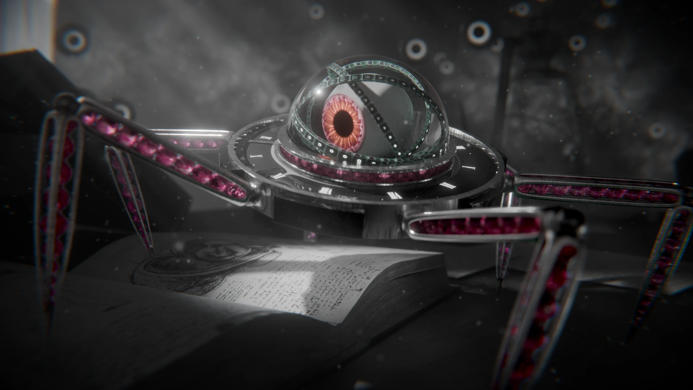
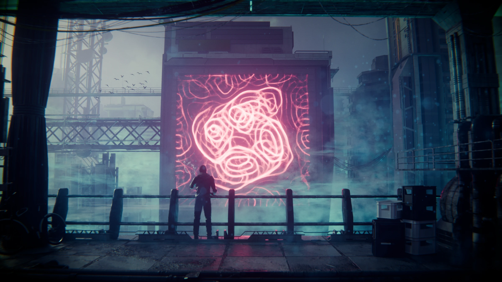
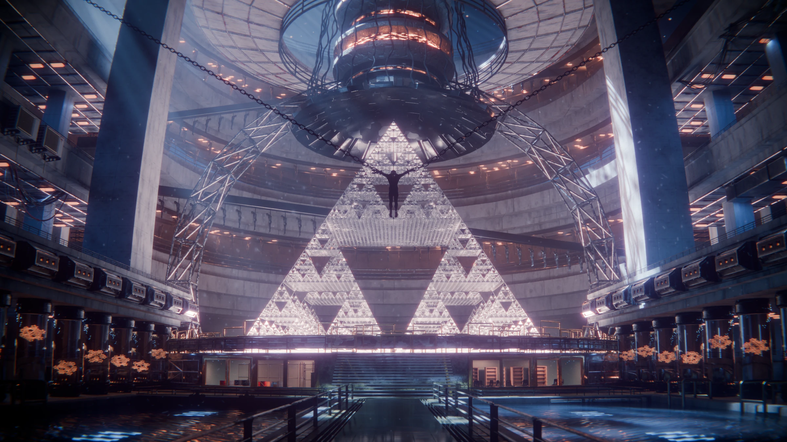

# Mazher Ghabour - Technical Portfolio

I use Geometry Nodes, the visual programming language in Blender, to translate mathematical ideas into computational systems.

I'm a recent high school graduate applying to undergraduate programs in robotics and artificial intelligence. This portfolio brings together three technical case studies and their cinematic renders, created in Blender.

## FABRIK - Procedural Kinematic Locomotion

A procedural locomotion system combining persistent foot state, phase-based gait scheduling, terrain queries, and the FABRIK inverse-kinematics algorithm. The study explains sequential distance corrections, parameterized chain topology, and spatial orientation, with explicit discussion of the model's limitations.

[Read the full technical study - PDF](FABRIK_Technical_Case_Study.pdf)

## Physarum - Agent-Based Simulation

A Physarum-inspired agent-and-field simulation using local sensing, persistent state, and shared scent memory. The study documents population controls, movement decisions, deposition, and field updates. The current output is an evolving field rather than an extracted shortest path.

[Read the full technical study - PDF](Physarum_Pattern_Formation_Technical_Case_Study.pdf)

## Fractals - From Recurrence to Geometry

Ten mathematical generators implemented through geometric recursion, probabilistic affine maps, and complex iteration. The study connects mathematical rules to procedural geometry and examines computational growth with depth, resolution, and iteration count.

[Read the full technical study - PDF](Fractals_Technical_Case_Study.pdf)

## Contact

[mazhsch102008@gmail.com](mailto:mazhsch102008@gmail.com)

---

The website is built with plain HTML and CSS and requires no dependencies or build step. For GitHub Pages, select **Deploy from a branch**, **main**, and **/ (root)** under **Settings → Pages**.

Project descriptions distinguish implemented behavior from proposed extensions. The cinematic environments present the work artistically; the linked studies explain the underlying systems. No blanket open-source license is granted for the portfolio text, renders, or studies.
